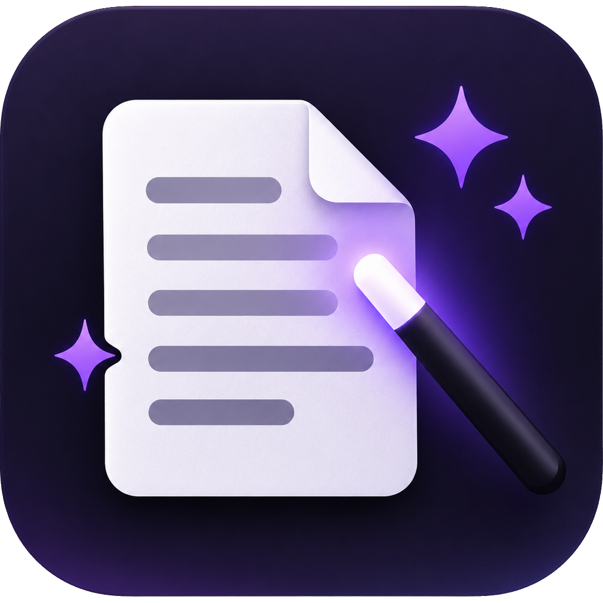
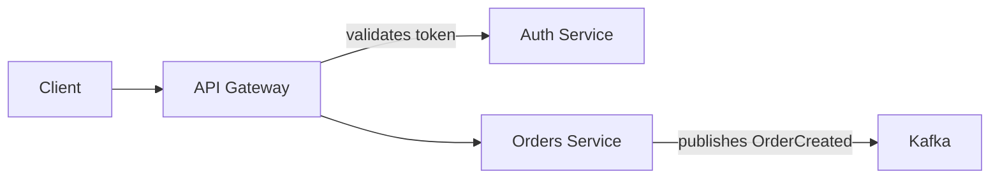

<div align="center">
  
</div>

<div align="center">
  <h1>Obsidian Note Creator</h1>
</div>

**A Claude skill that turns messy text into clean Obsidian notes.**

You paste something: an article, a book quote, a meeting summary, a tech idea, a random thought.
Claude gives you back a note that is clear, tagged and ready to drop into your Obsidian vault.

No copy-paste cleanup. No formatting by hand. Just good notes.

---

## ✨ What it does

| Feature | What you get |
|---|---|
| 🧹 **Clean structure** | Headings, lists, tables and code blocks, only where they help |
| 🏷️ **Smart tags** | 2 to 7 useful tags, in lowercase and `kebab-case` (like `#system-design`) |
| 📊 **Text diagrams** | Diagrams in Mermaid. Plain text, no images. Obsidian shows them right away |
| 🔍 **Quick fact-check** | Claude checks facts online, fixes old or wrong info, and adds a `## Sources` list |
| 🌎 **Right language** | Tech notes in English. Finance and personal notes in Brazilian Portuguese |
| ✂️ **One topic per note** | If you paste many unrelated topics, you get many notes |
| ✍️ **Better writing** | Fixes grammar and makes sentences clear, but keeps your meaning |
| 🚫 **No made-up stuff** | Claude does not invent facts, sources or links to notes you don't have |

---

## 📦 How to install

Pick the way that matches how you use Claude.

### Option 1: Claude app (claude.ai, desktop or mobile)

1. Go to the [Releases page](https://github.com/caiobozato/obsidian-note-creator/releases) and download `obsidian-note-creator.zip`.
2. Open Claude and go to **Customize → Skills**.
3. Click **+**, then **Create skill**, then **Upload a skill**.
4. Choose the ZIP file.
5. Make sure the skill is turned **on**.

> 💡 Custom skills need a paid plan (Pro, Max, Team or Enterprise) with code execution turned on.
> If you don't see the menu, check the [official help page](https://support.claude.com/en/articles/12512180-use-skills-in-claude).

### Option 2: Claude Code (as a plugin, easiest)

Run these two commands inside Claude Code:

```
/plugin marketplace add caiobozato/obsidian-note-creator
/plugin install obsidian-note-creator@obsidian-note-creator
```

That's it. You also get updates when this repo changes.

### Option 3: Claude Code (manual copy)

Copy the skill folder into your personal skills folder:

```bash
git clone https://github.com/caiobozato/obsidian-note-creator.git
mkdir -p ~/.claude/skills
cp -r obsidian-note-creator/skills/obsidian-note-creator ~/.claude/skills/
```

---

## 🚀 How to use

Just ask Claude to make a note. For example:

- *"Turn this article into an Obsidian note: ..."*
- *"Make a note from my meeting notes: ..."*
- *"Organize this book highlight for Obsidian: ..."*
- *"Create a note about how Kafka consumer groups work."*

Claude finds the skill by itself when you talk about notes or Obsidian.

### What you get back

The note name comes first. In Obsidian, the **file name is the title**, so the note itself has no big title on top.

```
📄 Kafka Consumer Groups.md
```

Then the note starts with tags:

```markdown
**Tags:** #kafka #distributed-systems #event-streaming

---

## What is a consumer group

A consumer group is a set of consumers that share the work of reading a topic...

## Sources

- [Apache Kafka Documentation](https://kafka.apache.org/documentation/)
```

Create a new note in Obsidian with that name, paste the content, done. ✅

---

## 📊 Diagrams with simple text

This is the fun part. You write a diagram with simple arrows, and Claude turns it into a Mermaid diagram.

**Start** with `[diagram]` and **end** with `[/diagram]`. Use `->` to connect things.

### You write

```
[diagram]
Client -> API Gateway
API Gateway -> Auth Service: validates token
API Gateway -> Orders Service
Orders Service -> Kafka: publishes OrderCreated
[/diagram]
```

### Claude writes

````markdown

````

### Obsidian shows


### Arrow cheat sheet

| You write | It means |
|---|---|
| `A -> B` | A goes to B |
| `A -> B: text` | A goes to B, with a label |
| `A <- B` | B goes to A |
| `A <-> B` | Both ways |
| `A --> B` | Optional or async (dotted line) |
| `A -> B, C` | A goes to B and to C |
| `A -> B -> C` | A chain: A to B, then B to C |
| `group Name:` + indented lines | Puts things in a box |

### Diagram types

Add a type after `diagram:` when you want something other than a flowchart:

```
[diagram: sequence]
User -> App: clicks "Buy"
App -> Payment API: charge card
Payment API -> App: success
[/diagram]
```

Supported types: `flow`, `sequence`, `class`, `er`, `state`, `mindmap`.

You can also add a title on the first line:

```
[diagram]
title: Login flow
User -> Login Page -> Auth Service
[/diagram]
```

> 💡 Claude only draws the boxes and arrows you wrote. It does not add new ones.

### 📖 Full diagram guide

Want examples for every diagram type (sequence, state, database, class, mind map), groups, tips and a cheat sheet?

👉 **Read the [Diagram Guide](docs/DIAGRAMS.md).**

---

## 🌎 Language rules

Claude picks the language based on the **topic**, not on the language you used.

| Topic | Language |
|---|---|
| 💻 Programming, system design, cloud, databases, APIs | English |
| 💰 Investments, stocks, FIIs, personal finance, real estate | Brazilian Portuguese |
| 🧘 Personal reflections, goals, routines | Brazilian Portuguese |
| 📚 Anything else | Same as the original text |

Tech words stay in their normal form, even in Portuguese notes (for example, "deploy" or "cache").

Want different languages? Edit the **Language Rules** section in `SKILL.md`.

---

## 🔍 Fact-checking

For each note, Claude does a **quick** check online:

- Checks technical, financial and factual claims
- Fixes wrong or old information
- Marks things it could not check
- Adds a `## Sources` section with links

It is a quick check, not a research paper. Simple notes get a simple check.
If Claude has no internet access, it says so. It never makes up sources.

---

## 📁 What's in this repo

```
obsidian-note-creator/
├── .claude-plugin/
│   ├── plugin.json          # Plugin info for Claude Code
│   └── marketplace.json     # Lets people install with /plugin
├── docs/
│   └── DIAGRAMS.md          # Full guide for the diagram tags
├── skills/
│   └── obsidian-note-creator/
│       └── SKILL.md         # The skill itself (all the rules live here)
├── LICENSE
└── README.md
```

---

## 🛠️ Make it yours

Everything lives in one file: [`skills/obsidian-note-creator/SKILL.md`](skills/obsidian-note-creator/SKILL.md).

Some easy changes:

- **Tags**: change the example tags to match the tags you already use in your vault
- **Languages**: change which topics use which language
- **Fact-checking**: remove step 7 if you want faster notes with no web search
- **File name line**: remove the `📄 Name.md` line if you don't need it

Fork the repo, change the file, and share your version!

---

## 🤝 Contributing

Found a bug or have an idea? Open an [issue](https://github.com/caiobozato/obsidian-note-creator/issues) or send a pull request.

---

## 📄 License

MIT. Use it, change it, share it.

Made with ☕ by Caio Bozato.
