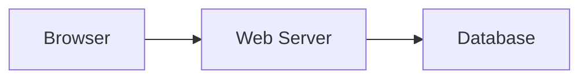
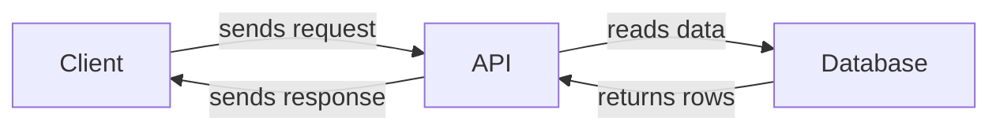
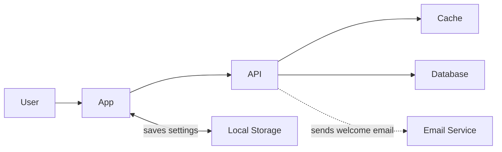
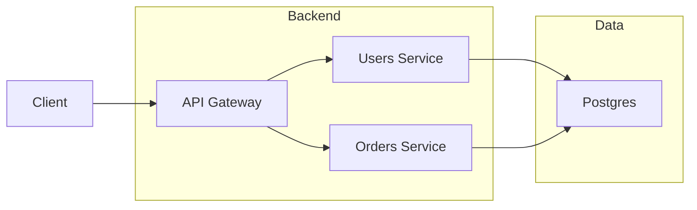
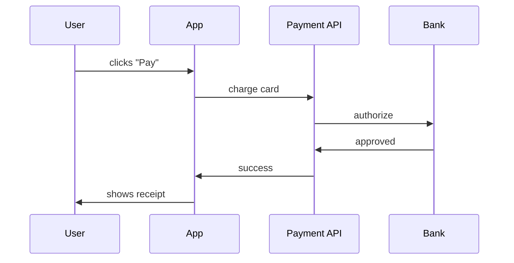
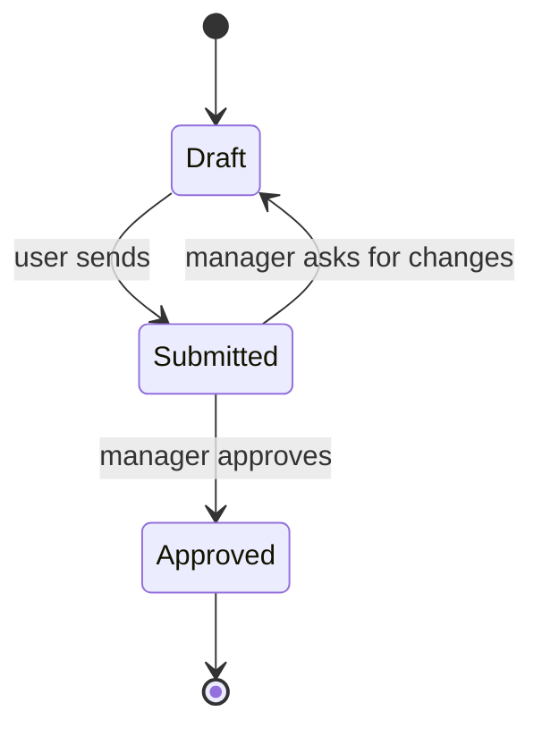
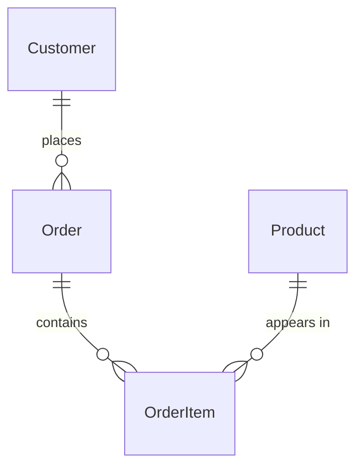
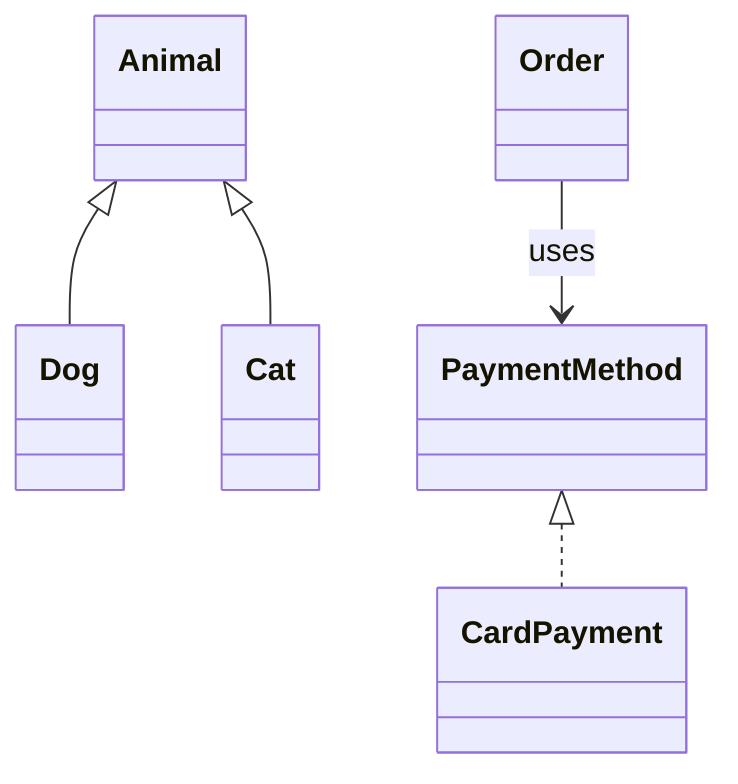
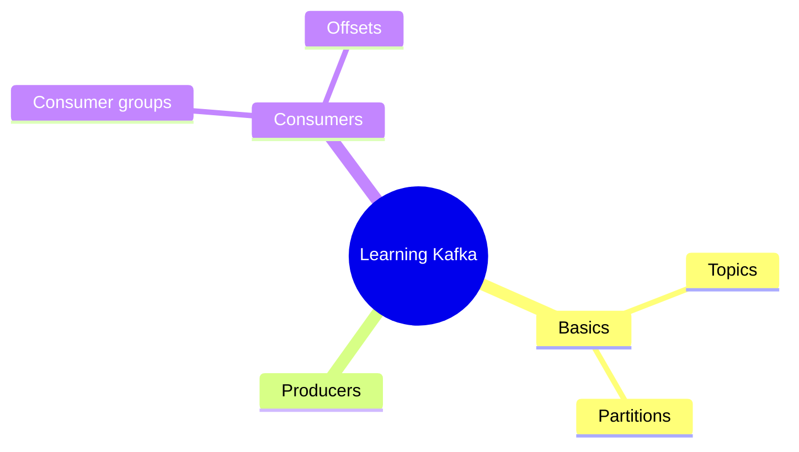

# 📊 Diagram Guide

Draw diagrams with simple text. Claude turns them into **Mermaid** diagrams that Obsidian shows right away.

No images. No drawing tools. Just arrows.

---

## Contents

1. [The basics](#1-the-basics)
2. [Text on arrows](#2-text-on-arrows)
3. [All the arrows](#3-all-the-arrows)
4. [Groups (boxes)](#4-groups-boxes)
5. [Titles](#5-titles)
6. [Diagram types](#6-diagram-types)
   - [Flowchart](#flowchart-default)
   - [Sequence](#sequence)
   - [State](#state)
   - [Entity relationship (database)](#entity-relationship-database)
   - [Class](#class)
   - [Mind map](#mind-map)
7. [Tips and common mistakes](#7-tips-and-common-mistakes)
8. [Cheat sheet](#8-cheat-sheet)

---

## 1. The basics

Put your diagram between two tags:

- `[diagram]` to **start**
- `[/diagram]` to **end**

Inside, write one connection per line with `->`.

**You write:**

```
[diagram]
Browser -> Web Server
Web Server -> Database
[/diagram]
```

**You get:**



You can mix diagrams with normal text. Claude puts each diagram in the same place where you wrote the tag.

---

## 2. Text on arrows

Add `:` after the connection, then your text. The text shows on the arrow.

**You write:**

```
[diagram]
Client -> API: sends request
API -> Database: reads data
Database -> API: returns rows
API -> Client: sends response
[/diagram]
```

**You get:**



> ⚠️ Everything after the first `:` becomes the arrow text. So don't use `:` inside names.

---

## 3. All the arrows

| You write | It means | Looks like |
|---|---|---|
| `A -> B` | A goes to B | solid arrow → |
| `A <- B` | B goes to A | solid arrow ← |
| `A <-> B` | Both ways | arrow on both ends ↔ |
| `A --> B` | Optional or async | dotted arrow ⇢ |
| `A -> B, C` | A goes to B **and** to C | two arrows |
| `A -> B -> C` | A to B, then B to C | a chain |

All of them can have text: `A <-> B: syncs data`, `A --> B: maybe later`.

**Example with many arrow types:**

```
[diagram]
User -> App -> API
API -> Cache, Database
API --> Email Service: sends welcome email
App <-> Local Storage: saves settings
[/diagram]
```



---

## 4. Groups (boxes)

Write `group Name:` and indent the lines below it. Claude draws a box around them.

**You write:**

```
[diagram]
Client -> API Gateway

group Backend:
  API Gateway -> Users Service
  API Gateway -> Orders Service

group Data:
  Users Service -> Postgres
  Orders Service -> Postgres
[/diagram]
```

**You get:**



---

## 5. Titles

Write `title:` on the first line to give the diagram a name.

```
[diagram]
title: Password reset flow
User -> App: clicks "Forgot password"
App -> Email Service: sends reset link
[/diagram]
```

Claude puts the title as a small heading above the diagram.

---

## 6. Diagram types

By default, you get a **flowchart**. To get another type, write it after `diagram:` in the start tag:

```
[diagram: sequence]
...
[/diagram]
```

| Type | Use it for |
|---|---|
| `flow` | Systems, processes, "what connects to what" (default) |
| `sequence` | Messages between people or systems, step by step in time |
| `state` | Things that change status (an order, a ticket, a job) |
| `er` | Database tables and how they relate |
| `class` | Classes, inheritance, code structure |
| `mindmap` | Ideas and topics in a tree |

---

### Flowchart (default)

Everything above (sections 1 to 5) is a flowchart. Use `[diagram]` or `[diagram: flow]`.

---

### Sequence

Each line is one message. The order of the lines is the order in time.

**You write:**

```
[diagram: sequence]
User -> App: clicks "Pay"
App -> Payment API: charge card
Payment API -> Bank: authorize
Bank -> Payment API: approved
Payment API -> App: success
App -> User: shows receipt
[/diagram]
```

**You get:**



> 💡 Use `-->` for messages that don't wait for an answer (async).

---

### State

Show how something moves from one status to another. Use `[start]` and `[end]` for the beginning and the end.

**You write:**

```
[diagram: state]
[start] -> Draft
Draft -> Submitted: user sends
Submitted -> Approved: manager approves
Submitted -> Draft: manager asks for changes
Approved -> [end]
[/diagram]
```

**You get:**



---

### Entity relationship (database)

Show tables and how they connect. Instead of `->`, use how many of each side:

| You write | It means |
|---|---|
| `1-1` | one to one |
| `1-n` | one to many |
| `n-1` | many to one |
| `n-n` | many to many |

Write table names **without spaces** (like `OrderItem`).

**You write:**

```
[diagram: er]
Customer 1-n Order: places
Order 1-n OrderItem: contains
Product 1-n OrderItem: appears in
[/diagram]
```

**You get:**



---

### Class

Show classes and how they relate. Use these words as the arrow text:

| You write | It means |
|---|---|
| `A -> B: extends` | A is a child of B |
| `A -> B: implements` | A follows the B interface |
| `A -> B: anything else` | A uses or has B |

Write class names **without spaces** (like `PaymentService`).

**You write:**

```
[diagram: class]
Dog -> Animal: extends
Cat -> Animal: extends
CardPayment -> PaymentMethod: implements
Order -> PaymentMethod: uses
[/diagram]
```

**You get:**



---

### Mind map

No arrows here. The first line is the main idea. Use **two spaces** to go one level deeper.

**You write:**

```
[diagram: mindmap]
Learning Kafka
  Basics
    Topics
    Partitions
  Producers
  Consumers
    Consumer groups
    Offsets
[/diagram]
```

**You get:**



> 💡 Mind maps need a recent version of Obsidian. If it doesn't show, update Obsidian.

---

## 7. Tips and common mistakes

✅ **Do**

- Write **one connection per line**.
- Use the **same name** every time for the same thing. `API` and `Api` are two different boxes.
- Keep diagrams **small**. More than ~15 boxes? Split into groups or into two diagrams.
- Pick the **right type**. Talking about time and messages? Use `sequence`. Talking about status? Use `state`.

❌ **Don't**

- Don't use `:` inside a name. `Service: v2 -> DB` breaks, because `v2 -> DB` becomes arrow text.
- Don't forget the end tag `[/diagram]`.
- Don't expect Claude to "fill in" missing parts. It only draws what you wrote. This is on purpose: your diagram stays true to your notes.

🤔 **Something looks wrong?**

- Check that the start and end tags are both there.
- Check that names are spelled the same everywhere.
- In Obsidian, open the note in **Reading view** or **Live Preview** to see the diagram.

---

## 8. Cheat sheet

```
[diagram]                    ← start (flowchart)
[diagram: sequence]          ← start with a type
title: My diagram            ← optional title (first line)

A -> B                       ← A to B
A -> B: text                 ← with text on the arrow
A <- B                       ← B to A
A <-> B                      ← both ways
A --> B                      ← dotted (optional / async)
A -> B, C                    ← A to B and A to C
A -> B -> C                  ← chain

group Name:                  ← box around the lines below
  A -> B

[start] -> A                 ← state diagrams only
A -> [end]

A 1-n B: text                ← er diagrams only (1-1, 1-n, n-1, n-n)

A -> B: extends              ← class diagrams only
A -> B: implements

[/diagram]                   ← end
```

Types: `flow` · `sequence` · `state` · `er` · `class` · `mindmap`

---

← Back to the [README](../README.md)
